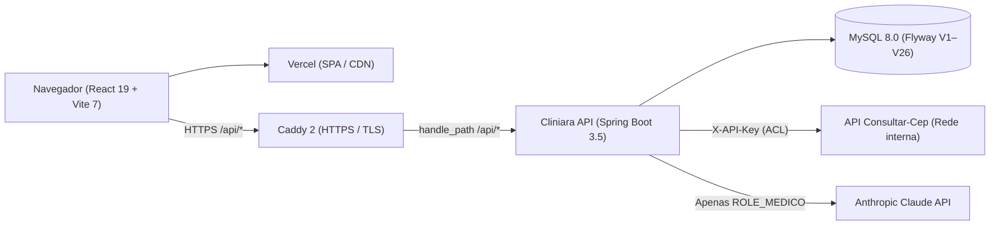
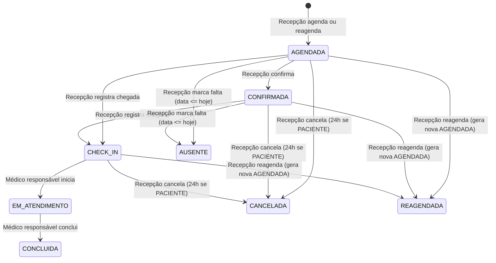

<div align="center">
  

  <p>
    <strong>Plataforma fullstack para gestão de clínicas médicas ambulatoriais</strong><br />
    Da agenda com disponibilidade real ao prontuário eletrônico, receitas, atestados, auditoria LGPD e indicadores gerenciais.
  </p>

  <p>
    <a href="https://github.com/alexandrepereira23/cliniara/actions/workflows/deploy.yml">
      
    </a>
    
    
    
    
    
    
  </p>
</div>

---

## Sobre o Projeto

O **Cliniara** é uma aplicação web fullstack voltada à rotina operacional, assistencial e gerencial de uma clínica médica multiespecialidades. O sistema modela o fluxo real entre recepção, corpo clínico, gestão e auditoria, priorizando integridade das regras de negócio, sigilo de dados sensíveis e rastreabilidade ponta a ponta.

> **Nota de escopo:** projeto autoral de engenharia de software desenvolvido para fins de estudo avançado e portfólio técnico, validado integralmente com dados sintéticos. Não representa software médico homologado para uso assistencial real.

### Destaques de Engenharia

- **Ciclo completo da consulta (`V26`):** máquina de estados com 8 estágios (`AGENDADA`, `CONFIRMADA`, `CHECK_IN`, `EM_ATENDIMENTO`, `CONCLUIDA`, `CANCELADA`, `AUSENTE` e `REAGENDADA`), vínculo histórico entre remarcações e trilha cronológica de quem alterou, quando e por quê.
- **Regras clínicas consistentes:** validação de disponibilidade médica real sem sobreposição, elegibilidade de convênio (`PLANO` com vigência da carteirinha vs `PARTICULAR`), retornos vinculados em até 30 dias restritos a consultas concluídas e prontuário eletrônico com janela de edição de 24 horas.
- **Segurança e RBAC em profundidade:** autenticação stateless via JWT, controle por método (`@PreAuthorize`) em 5 perfis, bloqueio de acesso da recepção a diagnósticos/anamneses (`403`), bloqueio `409 Conflict` ao tentar inativar médicos com consultas futuras pendentes e invalidação imediata de login/JWT para médicos inativados.
- **Auditoria LGPD automática via AOP:** aspecto Spring (`AuditoriaProntuarioAspect`) registrando leituras, criações e edições sobre prontuários, prescrições e atestados, consultáveis por prontuário ou diretamente por recurso clínico.
- **Integrações protegidas no servidor:** consumo backend-to-backend do serviço próprio [`Consultar-Cep`](https://github.com/alexandrepereira23/Consultar-Cep) via Anti-Corruption Layer (`RestClient` + header `X-API-Key` restrito ao backend) e apoio clínico supervisionado com IA (Anthropic Claude) exclusivo para `ROLE_MEDICO`.
- **Escala e performance:** buscas e filtros server-side com escape portável (`ESCAPE '!'`) e debounce no cliente, endpoints agregados para os 3 dashboards operacionais/gerenciais e code splitting por rota (`React.lazy`) no frontend.

---

## Arquitetura e Fluxos

### Topologia de Produção e Integrações



### Ciclo de Vida da Consulta



---

## Perfis de Acesso (RBAC e Privacidade)

O controle de acesso separa administração técnica, operação de recepção, ato médico e governança:

| Perfil | Escopo Principal | Limites de Segurança e Privacidade |
|---|---|---|
| `ROLE_ADMIN` | Cadastro/listagem de usuários operacionais, vínculo usuário↔médico com lock pessimista (`SELECT ... FOR UPDATE`) e consulta de CEP. | Não acessa médicos, pacientes, agenda nem qualquer conteúdo clínico. |
| `ROLE_FUNCIONARIO` | Cadastros (médicos, pacientes com CEP, especialidades, convênios, disponibilidade), agendamento, confirmação, check-in, ausência, reagendamento, cancelamento e dashboard da recepção. | Sem acesso a prontuários (`403` em `/prontuarios/**`); consulta receitas e atestados por paciente sem expor diagnóstico. |
| `ROLE_MEDICO` | Dashboard médico com fila de espera, início/conclusão das próprias consultas, prontuário eletrônico (edição em até 24h), prescrições, atestados e IA clínica (`/ia/*`). | Escopado estritamente aos próprios pacientes, consultas e prontuários. |
| `ROLE_GESTOR` | Dashboard gerencial (`/dashboard/gestor`) com indicadores agregados por período (7/30/90 dias), taxas de cancelamento/absenteísmo e produção por especialidade, além de leitura e auditoria. | Indicadores do dashboard são 100% agregados; leituras clínicas individuais geram trilha LGPD. |
| `ROLE_AUDITOR` | Inspeção da trilha LGPD por prontuário ou por recurso clínico (`PRONTUARIO`, `PRESCRICAO`, `ATESTADO`) e inativação administrativa auditada. | Sem ações de agendamento, cadastro operacional ou emissão clínica. |

---

## Stack Tecnológica

### Backend (`backend/`)

| Tecnologia | Versão / Papel |
|---|---|
| Java + Spring Boot | Java 17 · Spring Boot `3.5.4` (Web, Validation, AOP) |
| Segurança | Spring Security `6.5` · Auth0 `java-jwt` · BCrypt · Rate Limiting em `/auth/*` |
| Persistência e Schema | Spring Data JPA · Hibernate · MySQL `8.0` · Flyway (`V1`–`V26`, `ddl-auto=validate`) |
| Integrações | Spring `RestClient` (ACL `Consultar-Cep` com timeouts e `X-API-Key`) · Anthropic Claude API |
| Documentação e Testes | SpringDoc OpenAPI (Swagger UI em dev) · JUnit 5 · Mockito · H2 in-memory |

### Frontend (`frontend/`)

| Tecnologia | Versão / Papel |
|---|---|
| Core | React `19` · TypeScript `5.6` · Vite `7` |
| Interface e Rotas | Tailwind CSS `v4` · shadcn/ui (Radix UI) · Lucide Icons · `wouter` + `React.lazy` |
| Formulários e HTTP | React Hook Form · Zod `v4` · Axios (interceptors JWT e tratamento de sessão) |
| Testes | Vitest · Testing Library · Playwright (E2E Chromium) |

### Infraestrutura e Entrega

- **Local:** `docker-compose.yml` orquestrando MySQL 8.0, backend Spring Boot e frontend com Nginx.
- **Produção:** frontend na **Vercel**; backend, API `Consultar-Cep`, MySQL e **Caddy 2** (HTTPS automático e reverse proxy `handle_path /api/*`) em **VPS Linux** via `docker-compose.prod.yml`.
- **CI/CD (`.github/workflows/deploy.yml`):** executa testes backend, testes frontend, typecheck, build de produção (job `test`) e a suíte E2E Playwright contra MySQL 8.0 real + Flyway `V1`–`V26` (job `e2e`) antes de liberar o deploy via SSH na branch `main`.

---

## Estrutura do Repositório

```text
cliniara/
├── backend/                     # API REST Spring Boot (pacote com.cliniara.api)
│   ├── src/main/java/           # 16 controllers, domain, services, security, AOP e cliente CEP
│   ├── src/main/resources/      # application.properties e migrations Flyway (V1–V26)
│   └── src/test/                # 279 testes (unitários, @WebMvcTest e integração JPA/H2)
├── frontend/                    # SPA React 19 + TypeScript + Vite 7
│   ├── public/                  # Logo oficial, favicons e webmanifest
│   ├── src/                     # Páginas lazy, dashboards por perfil, clientes de API, hooks e 47 testes Vitest
│   ├── e2e/                     # 9 testes E2E Playwright + stub autenticado do serviço de CEP
│   └── docs/                    # Arquitetura, Design System e contratos HTTP do frontend
├── deploy/                      # Caddyfile de produção (HTTPS reverso na VPS)
├── docs/                        # Documentação de arquitetura, regras de negócio, endpoints, testes e deploy
├── docker-compose.yml           # Ambiente fullstack local
└── docker-compose.prod.yml      # Stack de produção na VPS
```

---

## Como Executar Localmente

### Pré-requisitos

- **Com Docker (recomendado):** Docker Engine + Docker Compose.
- **Para desenvolvimento sem containers na aplicação:** JDK 17+, Node.js 22+ e uma instância MySQL 8.0 (pode subir apenas o banco pelo Compose).

### 1. Configurar variáveis de ambiente

Copie o arquivo de exemplo de desenvolvimento para `backend/.env`:

```bash
# Linux / macOS / Git Bash
cp backend/.env.example backend/.env
```

```powershell
# Windows PowerShell
Copy-Item backend/.env.example backend/.env
```

Principais variáveis lidas por `backend/.env`:

| Variável | Descrição | Padrão em dev (`.env.example`) |
|---|---|---|
| `DB_HOST`, `DB_PORT`, `DB_NAME` | Conexão MySQL (`3307` no host, `db:3306` no Compose) | `localhost`, `3307`, `cliniara_api` |
| `DB_USER`, `DB_PASSWORD` | Credenciais do banco | `root`, `root` |
| `JWT_SECRET` | Segredo HMAC do JWT (mínimo 32 caracteres) | Chave local de exemplo |
| `ADMIN_LOGIN`, `ADMIN_PASSWORD` | Criação idempotente do `ROLE_ADMIN` inicial | `admin@cliniara.com`, `admin123` |
| `CEP_API_BASE_URL`, `CEP_API_KEY` | URL e chave `X-API-Key` do serviço `Consultar-Cep` | `http://localhost:8081`, vazio |
| `ANTHROPIC_API_KEY` | Chave para os endpoints `/ia/*` (opcional para subir a API) | vazio |
| `RATE_LIMIT_MAX_REQUESTS` | Limite de tentativas em `/auth/*` a cada 15 min | `10` (`200` na suíte E2E) |

> Nunca reutilize os valores de `backend/.env.example` fora do ambiente local. Para produção, consulte `.env.production.example` e [`docs/DEPLOY_VPS.md`](docs/DEPLOY_VPS.md).

### 2. Opção A — Subir toda a stack com Docker Compose

```bash
docker compose --env-file backend/.env up --build
```

- **Frontend (Nginx):** `http://localhost:3000`
- **API Backend:** `http://localhost:8080`
- **Swagger UI:** `http://localhost:8080/swagger-ui.html`
- **MySQL:** `localhost:3307`

### 3. Opção B — Rodar Backend e Frontend em modo desenvolvimento

```bash
# 1. Subir apenas o MySQL 8.0 em background
docker compose --env-file backend/.env up -d db

# 2. Iniciar o backend Spring Boot (porta 8080)
cd backend
./mvnw spring-boot:run
```

Em outro terminal:

```bash
# 3. Iniciar o servidor Vite com proxy /api -> :8080 (porta 5173)
cd frontend
npm install
npm run dev
```

Acesse `http://localhost:5173` e autentique-se inicialmente com o `ADMIN_LOGIN` / `ADMIN_PASSWORD` definidos no seu `backend/.env` para cadastrar os usuários operacionais (`ROLE_FUNCIONARIO`, `ROLE_MEDICO`, `ROLE_GESTOR` e `ROLE_AUDITOR`).

---

## Qualidade e Testes Automatizados

O repositório conta com **335 testes automatizados** distribuídos em três níveis:

| Camada | Comando | Escopo Validado | Total |
|---|---|---|---:|
| **Backend (JUnit 5 + Mockito + H2)** | `cd backend && ./mvnw test` | Regras de agendamento, ciclo de 8 status, retornos, convênios, prontuário 24h, bloqueio `409` de médico, dashboards, ACL de CEP, auditoria AOP, filtro JWT e `@WebMvcTest` nos 16 controllers | **279** |
| **Frontend (Vitest + Testing Library)** | `cd frontend && npm test` | Interceptors Axios/401, sessão JWT, busca de CEP, ciclo/reagendamento/histórico de consultas, prontuários, auditoria LGPD, filtros server-side e dashboards | **47** |
| **End-to-End (Playwright + Chromium)** | `cd frontend && npm run test:e2e` | Jornada completa no navegador real: login/RBAC, criação de usuários, CEP via stub autenticado, disponibilidade, agendamento, confirmação, check-in, bloqueio `409`, início/conclusão médica, prontuário, prescrição e auditoria LGPD | **9** |

Verificações adicionais de tipagem e empacotamento no frontend:

```bash
cd frontend
npm run check   # tsc --noEmit
npm run build   # tsc -b && vite build (code splitting por rota)
```

> A suíte E2E (`npm run test:e2e`) sobe automaticamente o backend, o stub HTTP do `Consultar-Cep` e o Vite dev server. Se o MySQL estiver acessível na porta `3307`, roda com Flyway real; caso contrário, utiliza H2 em memória automaticamente (veja [`docs/TESTES.md`](docs/TESTES.md)).

---

## Documentação Técnica

Toda a especificação detalhada do projeto é mantida versionada dentro do repositório:

- [`docs/ENDPOINTS.md`](docs/ENDPOINTS.md) — catálogo completo de rotas REST, parâmetros, payloads e códigos HTTP.
- [`docs/REGRAS_DE_NEGOCIO.md`](docs/REGRAS_DE_NEGOCIO.md) — regras clínicas, ciclo da consulta, elegibilidade de convênios e matriz RBAC.
- [`docs/DECISOES_TECNICAS.md`](docs/DECISOES_TECNICAS.md) — decisões arquiteturais (ADRs), segurança, integrações e trade-offs.
- [`docs/TESTES.md`](docs/TESTES.md) — estratégia de testes unitários, slice web, integração e E2E.
- [`docs/DEPLOY_VPS.md`](docs/DEPLOY_VPS.md) — guia operacional de deploy em VPS Linux com Docker Compose, Caddy HTTPS e GitHub Actions.
- [`docs/BACKLOG.md`](docs/BACKLOG.md) e [`docs/PLANEJAMENTO.md`](docs/PLANEJAMENTO.md) — histórico de entregas concluídas e próximos incrementos planejados.
- [`docs/ANALISE_PROJETO.md`](docs/ANALISE_PROJETO.md) e [`docs/ANALISE_EVOLUCAO_CLINICA.md`](docs/ANALISE_EVOLUCAO_CLINICA.md) — diagnóstico técnico e roadmap de evolução do produto clínico.
- [`frontend/docs/ARCHITECTURE.md`](frontend/docs/ARCHITECTURE.md), [`frontend/docs/API_CONTRATOS.md`](frontend/docs/API_CONTRATOS.md) e [`frontend/docs/DESIGN_SYSTEM.md`](frontend/docs/DESIGN_SYSTEM.md) — documentação dedicada da SPA.

---

## Autor

Desenvolvido por **Alexandre Henrique** — [@alexandrepereira23](https://github.com/alexandrepereira23)
